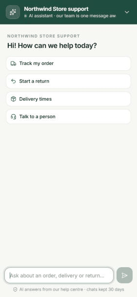
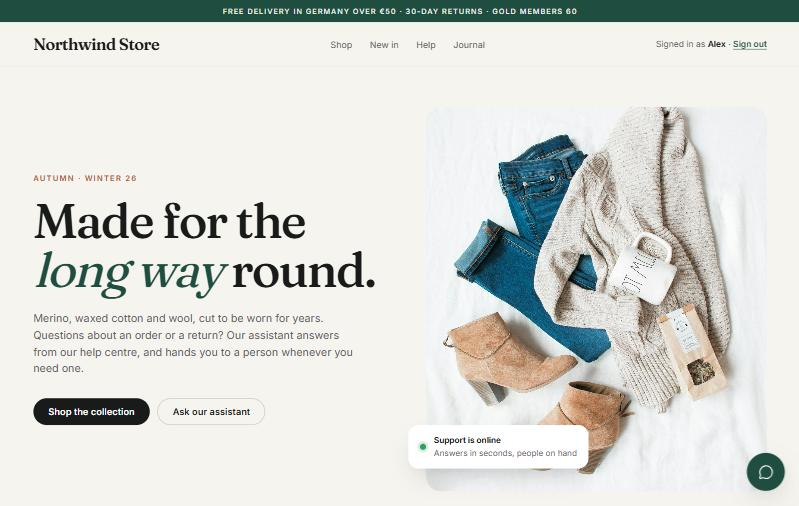
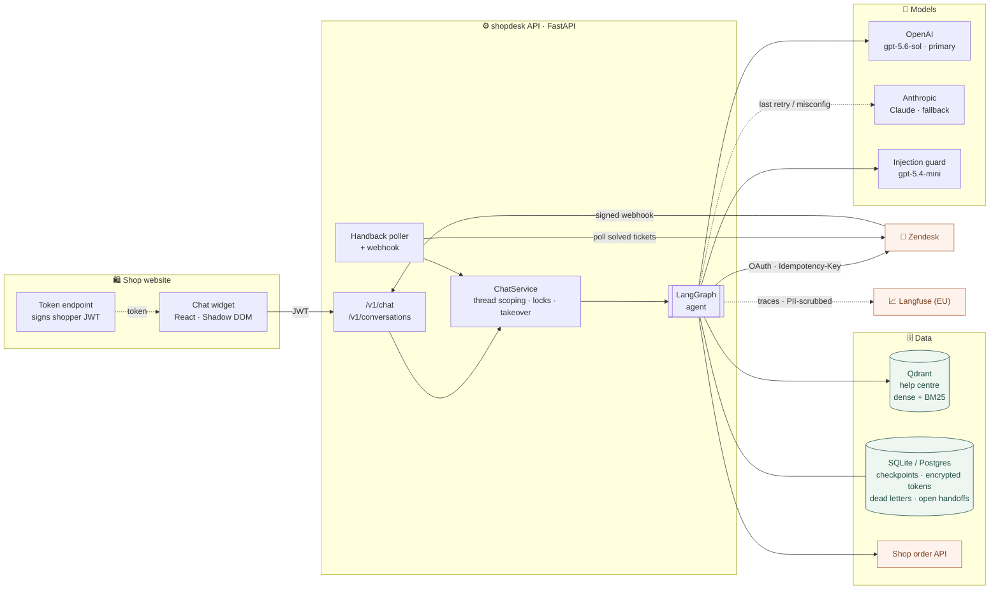
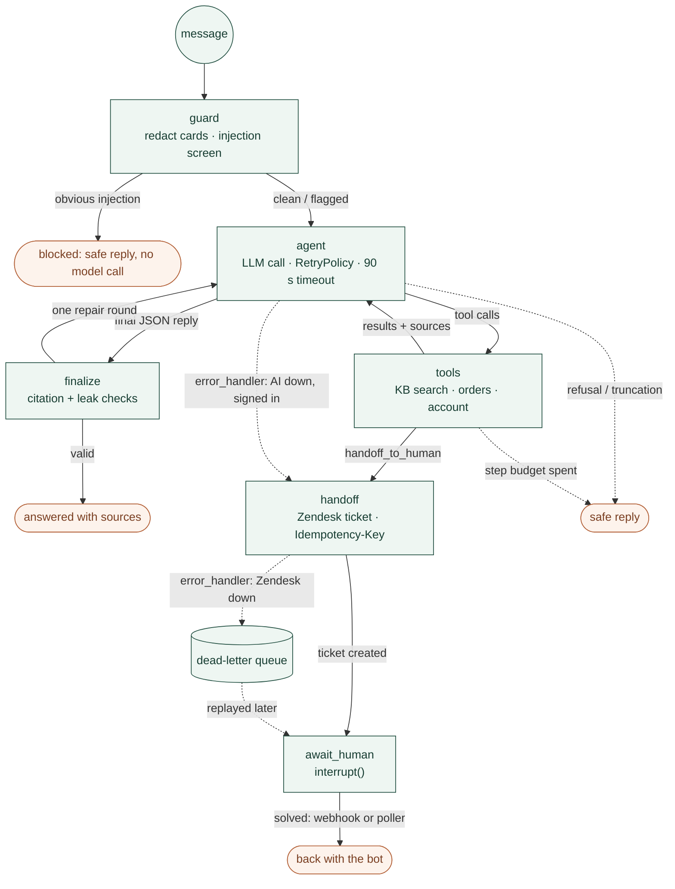
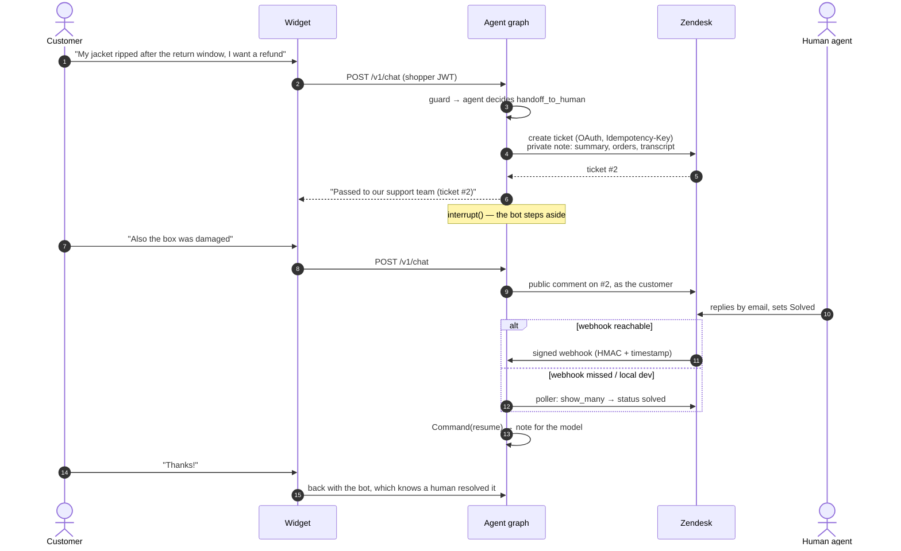
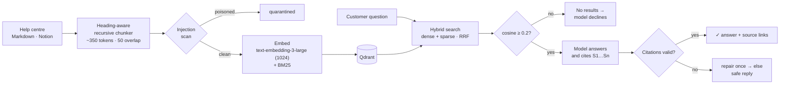

<div align="center">

# shopdesk

**An AI customer-support agent for e-commerce that knows when to answer, when to say
"I don't know", and when to hand you to a human.**

It answers from the shop's own help centre with citations, looks up the signed-in
customer's live orders, and hands off to Zendesk with full context. While a person owns
the ticket the bot steps aside, and it picks the conversation back up once the ticket is
solved.


<br>



&nbsp;&nbsp;


</div>

---

> **Guides:** [Architecture (high & low level)](docs/ARCHITECTURE.md) · [Running & deployment (Docker, local, production)](docs/RUNNING.md)

## Contents

- [What it does](#what-it-does)
- [Architecture](#architecture)
- [The agent graph](#the-agent-graph)
- [Human handoff, end to end](#human-handoff-end-to-end)
- [Retrieval: answering and declining](#retrieval-answering-and-declining)
- [Failure policy](#failure-policy)
- [Prompt-injection defence](#prompt-injection-defence)
- [GDPR](#gdpr)
- [Evals](#evals)
- [Quickstart](#quickstart)
- [Configuration](#configuration)
- [Tests](#tests)

## What it does

| | |
|---|---|
| 📚 **Grounded answers** | Hybrid search over the help centre (OpenAI embeddings + BM25 in Qdrant). Every policy answer cites its sources, and citations are checked against what was actually retrieved. |
| 🙅 **Knows when to decline** | "Do you offer gift wrapping?" gets an honest "I don't have that information", not a confident guess. |
| 📦 **Live order lookups** | Status, tracking and return window, always scoped to the signed-in customer. The model can't ask for anyone else's order. |
| 🧑‍💼 **Human handoff** | Refunds, fraud, legal, GDPR requests or "I want a person" create a Zendesk ticket with a summary, the transcript and the orders discussed. |
| 🔁 **Handback** | When the agent solves the ticket, a signed webhook (or a polling fallback) hands the chat back to the bot. |
| 🛡️ **Safe by construction** | Layered prompt-injection defence, PII redaction, encrypted secrets, retention and erasure. |
| 🧯 **Fails gracefully** | Retries, a cross-provider model fallback, automatic handoff when the AI is down, and a dead-letter queue when Zendesk is. |
| 💬 **Embeddable widget** | One `<script>` tag. React 18 in a Shadow DOM, about 54 kB gzipped, light and dark themes, works on phones. |

## Architecture



## The agent graph

The agent is a LangGraph state machine (`src/shopdesk/agent/graph.py`). Each node has its
own retry policy, timeout and error handler, so a failure goes down a defined path instead
of crashing the conversation.



<details>
<summary><b>The agentic loop in detail</b></summary>

1. **guard**: card numbers and IBANs are redacted, then heuristics plus a small LLM
   classifier screen for prompt injection. Obvious attacks never reach the model, and
   borderline ones get an operator note.
2. **agent**: the model sees the instructions, the provider-neutral transcript and five
   strict tools. Attempts 1 and 2 go to the primary model and attempt 3 to the fallback; a
   bad key or unknown model skips straight to the fallback.
3. **tools**: KB search and order or account lookups run in parallel, each scoped to the
   customer from the verified JWT. Search results get conversation-wide source IDs (`S1`,
   `S2`, ...) the model must cite.
4. **finalize**: the reply is strict JSON (`answer`, `citations`, `grounded_in`,
   `confidence`). Unknown citations, KB claims without sources, prompt-canary leaks or tool
   names trigger one repair round, then a safe "let me connect you" reply.
5. **handoff**: the ticket is built deterministically, and every retry sends the same
   `Idempotency-Key`, so a retry never creates a second ticket.
6. **await_human**: the graph pauses on `interrupt()`. Customer messages go to the ticket as
   public comments until the agent solves it and `Command(resume=...)` hands back.

</details>

## Human handoff, end to end



If Zendesk is down, the ticket goes to an **encrypted dead-letter queue** and the customer
is still told the team will reply. A replay worker delivers it later under the same
idempotency key, and adds anything the customer wrote in the meantime.

## Retrieval: answering and declining



**Why there's no reranker gate.** My first version gated answers on a cross-encoder score,
and the live evals showed why that's wrong: no single score separates "covered" from "not
covered". A terse query like "return window for jumpers" scored *below* "can I pay with
bitcoin" (which the payments page does answer), and the English-only reranker pushed the
right chunk out of the top 5 for German questions. So retrieval now only drops clear junk
(off-topic questions scored 0.10–0.14 cosine). The model judges whether the sources cover
the question, and the citation check holds it to them. A multilingual reranker
(`BAAI/bge-reranker-v2-m3-int8`) is opt-in.

**Chunking.** Documents are cut at headings first, so a chunk never mixes topics, then split
recursively (paragraph → line → sentence → word) with overlap. Each chunk is embedded with
its heading path ("Returns > International returns"). Re-ingesting is idempotent:
unchanged docs are skipped, and changed ones are written as a new version before the old one
is deleted, so search never sees a gap.

## Failure policy

| What breaks | What happens |
|---|---|
| LLM 429 / 5xx / timeout | `RetryPolicy` with backoff; the last attempt runs on the **other provider** |
| Primary misconfigured (bad key, unknown model) | Skips retries and goes straight to the fallback |
| All LLM attempts fail | `error_handler` **auto-hands signed-in customers to a human**; guests get the support email |
| Model refuses / truncates | Fixed safe reply; nothing partial is shown |
| Invented citation, prompt leak, tool names in the reply | One repair round, then "let me connect you" |
| Zendesk 429 / 5xx | Node retries; same `Idempotency-Key`, so no duplicate tickets |
| Zendesk down or 4xx | **Dead-letter queue** (encrypted), lease-based replay, backoff up to 6 h, `dead` after 12 tries |
| Zendesk token expired / revoked | Refresh with rotation under a lock; one retry |
| Solved-ticket webhook lost | Poller reconciles open handoffs against Zendesk |
| Shop backend forgets customer scoping | Client re-checks ownership on every order and drops foreign ones |

Every row has a test, and most run end to end against stand-in Zendesk and shop servers.

## Prompt-injection defence

No single filter is trusted; the controls that matter are structural.

- **Server-side scoping.** Tools take the customer ID from the verified JWT, never from
  the model. "Show me order 100777" can't return someone else's order, even if the backend
  forgets to check.
- **No dangerous tools.** Nothing that moves money or edits accounts; those always go to a
  human.
- **Spotlighting.** Retrieved text and order data are delimited and HTML-escaped, so a
  poisoned help article can't close the tags. Chunks that look like instructions are
  quarantined at ingestion.
- **Input screen.** Heuristics block obvious attacks before any model call; an LLM
  classifier flags the rest.
- **Output checks.** Replies are scanned for the system-prompt canary and internal tool
  names.
- **Red-team evals.** Override, role-play, prompt-leak and cross-customer cases run against
  the real model.

## GDPR

- **Minimisation.** Card numbers (Luhn-checked) and IBANs (mod-97-checked) are removed
  before anything reaches the model or storage; tracking numbers survive. The model never
  sees addresses or customer IDs.
- **Logs and traces.** structlog and Langfuse (EU region) both go through a scrubber, and
  traces use keyed-HMAC pseudonyms.
- **Providers.** OpenAI calls use `store=False`. The EU data-residency endpoint is a config
  switch, and embeddings can run fully locally.
- **Retention.** A daily job deletes idle conversations and trims active ones to their
  latest checkpoint.
- **Erasure.** `DELETE /v1/conversations/{id}` removes the thread, any queued handoff and
  the open-handoff record.
- **Secrets at rest.** Zendesk tokens and dead letters (which contain transcripts) are
  Fernet-encrypted.
- **Fonts.** Served from our own host, never Google's CDN (loading Google Fonts without
  consent has been ruled a breach in Germany).
- **Data-subject requests.** "Delete my data" in chat goes to a human, who verifies identity.

## Evals

`python -m evals.run` runs 21 behavioural and red-team cases against the real model,
knowledge base and order data, and sends per-check scores to Langfuse.

| Category | Cases | Result with `gpt-5.6-sol` |
|---|---|---|
| Grounded answers (incl. German) | 7 | ✅ |
| Order lookups & customer scoping | 3 | ✅ |
| Declines (out of scope, not in KB) | 3 | ✅ |
| Handoffs (refund, GDPR, chargeback, address change) | 4 | ✅ |
| Injection & data-leak attacks | 3 | ✅ |
| Card number in message | 1 | ✅ |
| **Total** | **21** | **21 / 21, two runs in a row** |

The first live run scored 13/18. Three failures were grader bugs (typographic quotes and
dashes, an over-strict expectation) and two were real retrieval problems, fixed as
described above. "Did it decline?" is graded by a small LLM judge, not string matching.

## Quickstart

**Docker** (everything in one command, SQLite on a volume):

```bash
cp .env.example .env            # add OPENAI_API_KEY, QDRANT_URL, QDRANT_API_KEY
docker compose up -d --build
docker compose run --rm app python -m shopdesk.rag.ingest --markdown kb
```

**Local** (for development):

```bash
uv sync
(cd widget && npm ci && npm run build)                # builds the chat widget
cp .env.example .env                                  # add your keys
uv run python -m shopdesk.rag.ingest --markdown data/kb
uv run python -m shopdesk.devserver                   # http://localhost:8000
```

`http://localhost:8000/` opens a demo storefront with the widget and a "sign in as Alex"
toggle. Without Zendesk or shop credentials, the app uses a local ticket sink and demo
orders.

<details>
<summary><b>Embed the widget in a real shop</b></summary>

```html
<script src="https://support-api.example.com/widget/shopdesk-widget.js"
        data-api-base="https://support-api.example.com"
        data-token-url="/account/support-token"
        data-title="Northwind support" data-accent="#1f4d3f" defer></script>
```

`data-token-url` is an endpoint on the shop's backend returning `{"token": "<jwt>"}` for a
signed-in shopper (HS256; `sub`, `email`, `given_name`, `aud=shopdesk-widget`, `exp`), or
`{"token": null}` for guests.

</details>

<details>
<summary><b>Shop API contract</b></summary>

| Endpoint | Returns |
|---|---|
| `GET /customers/{customer_id}/orders/{order_id}` | one `Order`, or 404 if it isn't this customer's |
| `GET /customers/{customer_id}/orders?limit=5&sort=-placed_at` | `{"orders": [Order, ...]}` |
| `GET /customers/{customer_id}` | `Account` |

The models are in `integrations/commerce.py`. The client re-checks ownership, so a backend
that forgets to scope still can't leak an order.

</details>

<details>
<summary><b>Zendesk setup</b></summary>

1. Admin Center → Apps and integrations → **APIs → OAuth clients** → add a *Confidential*
   client with redirect URL `https://<host>/v1/zendesk/oauth/callback` and scopes
   `tickets:read tickets:write users:read users:write`.
2. Open `/v1/zendesk/oauth/start` (basic auth: `admin` / `ADMIN_TOKEN`) and click Allow.
   The flow uses PKCE, an encrypted state and a browser-bound nonce. Tokens are stored
   encrypted and refreshed with rotation.
3. Handback: create a webhook to `https://<host>/v1/zendesk/webhook` with its signing secret
   in `ZENDESK_WEBHOOK_SECRET`, plus a trigger on *Status is Solved* + tag `shopdesk` that
   sends `{"ticket_id": {{ticket.id}}, "external_id": "{{ticket.external_id}}", "status": "{{ticket.status}}"}`.
   Where Zendesk can't reach you, set `ZENDESK_HANDBACK_POLL_SECONDS` instead.

</details>

## Configuration

| Variable | Purpose |
|---|---|
| `OPENAI_API_KEY`, `OPENAI_AGENT_MODEL`, `OPENAI_GUARD_MODEL` | primary model, injection screen, embeddings |
| `ANTHROPIC_API_KEY` | cross-provider fallback (Claude) |
| `QDRANT_URL`, `QDRANT_API_KEY`, `QDRANT_COLLECTION` | knowledge base |
| `LANGFUSE_PUBLIC_KEY`, `LANGFUSE_SECRET_KEY`, `LANGFUSE_BASE_URL` | tracing and eval scores |
| `ZENDESK_SUBDOMAIN`, `ZENDESK_CLIENT_ID`, `ZENDESK_CLIENT_SECRET` | OAuth client for handoff |
| `ZENDESK_WEBHOOK_SECRET`, `ZENDESK_HANDBACK_POLL_SECONDS` | handback via webhook and/or polling |
| `COMMERCE_API_URL`, `COMMERCE_API_KEY` | the shop's order API (demo orders if unset) |
| `DATABASE_URL` | `sqlite:///data/shopdesk.db` (single server) or `postgresql://…` (replicas) |
| `WIDGET_JWT_SECRET`, `ADMIN_TOKEN`, `TOKEN_ENCRYPTION_KEY`, `PSEUDONYM_KEY` | app secrets, required outside dev |

See [`.env.example`](.env.example) for every option.

## Tests

```bash
uv run pytest --cov                                    # 146 tests
uv run ruff check src tests evals && uv run mypy src   # strict typing
cd widget && npm test                                  # 16 widget tests
```

- **Graph tests** script the model, so every failure path is deterministic and fast.
- **End-to-end tests** run the real app over HTTP against stand-in Zendesk and shop servers
  that are strict where integrations break: PKCE is verified, refresh tokens rotate, tickets
  honour `Idempotency-Key` (including "created, but the response was lost"), webhooks are
  signed, and one shop backend forgets to scope.
- **Storage tests** run against real SQLite and Postgres: encryption at rest, dead-letter
  leases, takeover surviving a restart, retention.
- **Coverage** is 89% branch-aware with an 80% CI gate. It's deliberately uneven: graph,
  security, privacy and integration clients sit at 90%+, because that's where a bug costs
  money or leaks data.

<details>
<summary><b>Project layout</b></summary>

```
src/shopdesk/
  agent/          graph · tools · prompts · provider adapters · transcript
                  handoff · handback · dead letters · chat service
  rag/            chunking · loaders (markdown, Notion) · embeddings · Qdrant store · retriever
  integrations/   http retries · shop API · zendesk (oauth, credentials, client)
  security/       prompt-injection guard
  api/            routes · JWT / admin / webhook auth · dev storefront
  privacy.py      redaction and scrubbing
  retention.py    storage-limitation job
  storage_sqlite.py
widget/           React chat widget (Vite library build, Vitest)
evals/            behavioural + red-team cases
tests/            unit · integration · e2e (stand-in Zendesk & shop)
data/kb/          sample help-centre articles
```

</details>
