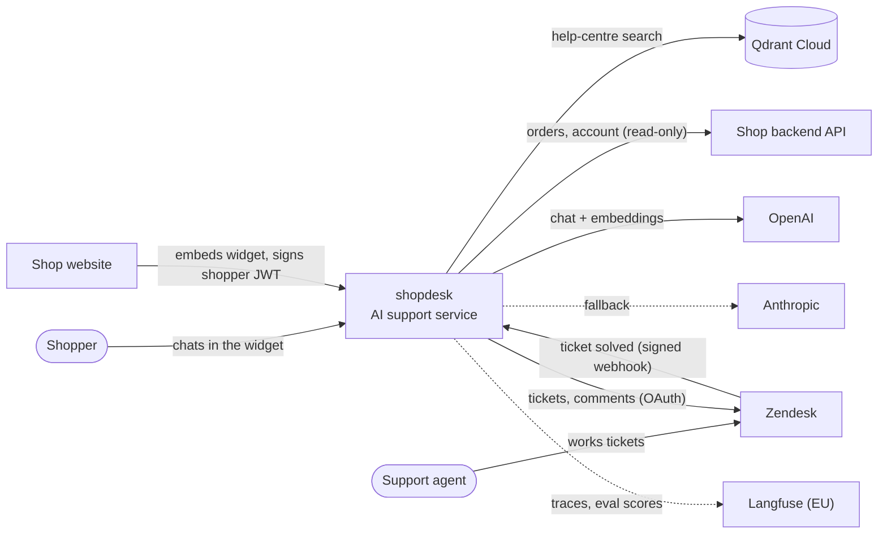
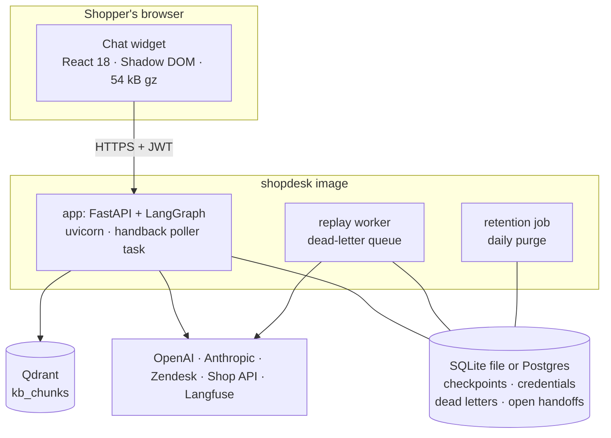
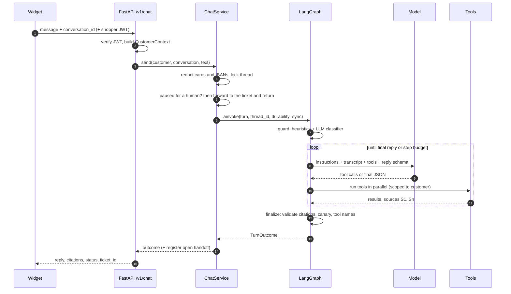
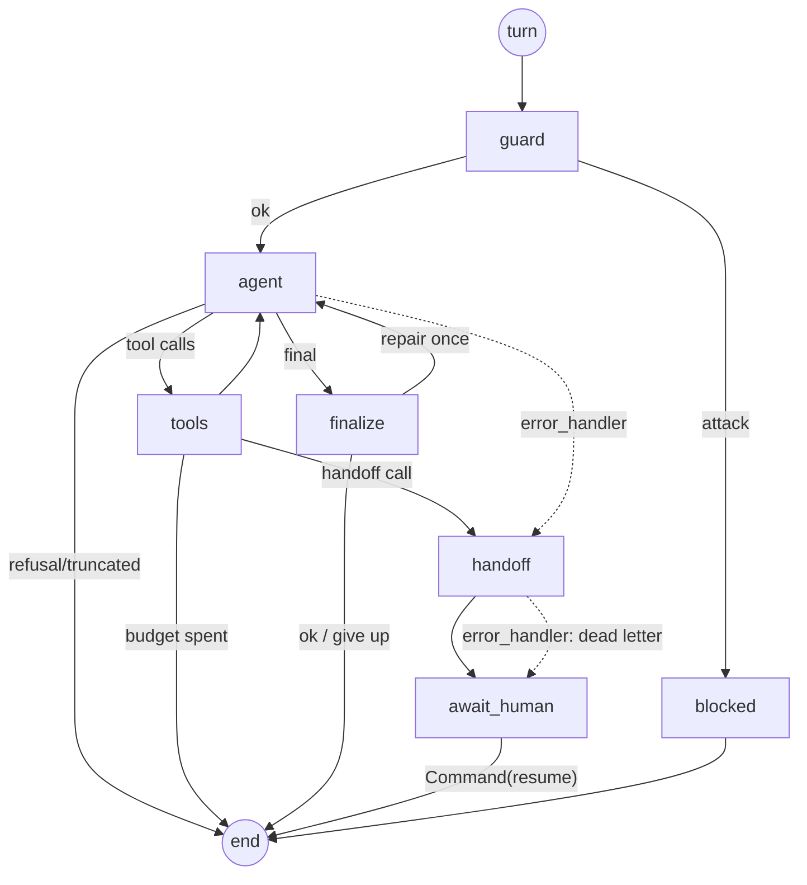
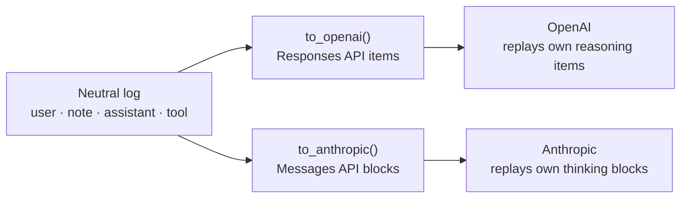
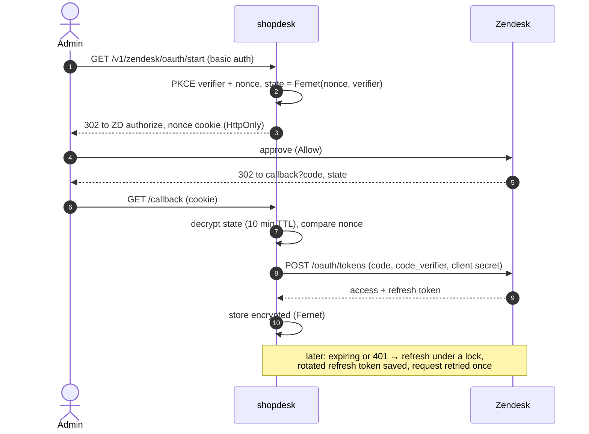
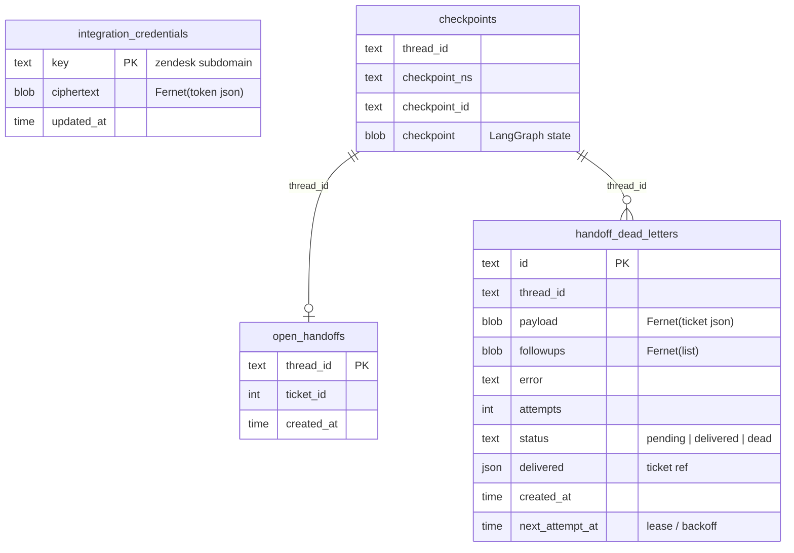

# Architecture

This guide goes from the whole system down to individual modules. Read the
[high-level](#part-1-high-level) part to understand what talks to what. Read the
[low-level](#part-2-low-level) part before changing code.

- [Part 1: High level](#part-1-high-level)
  - [System context](#system-context)
  - [Containers](#containers)
  - [Request lifecycle](#request-lifecycle)
  - [Deployment topologies](#deployment-topologies)
  - [Key design decisions](#key-design-decisions)
- [Part 2: Low level](#part-2-low-level)
  - [Module map](#module-map)
  - [Agent graph: nodes and state](#agent-graph-nodes-and-state)
  - [Transcript: one log, two providers](#transcript-one-log-two-providers)
  - [Tools](#tools)
  - [Retrieval](#retrieval)
  - [Zendesk integration](#zendesk-integration)
  - [Storage schemas](#storage-schemas)
  - [HTTP API](#http-api)
  - [Security controls](#security-controls)
  - [Observability](#observability)

---

## Part 1: High level

### System context

Who and what the system talks to.



### Containers

What runs where. Everything in the dashed box ships as one Docker image, run as three
processes.



| Process | Command | What it does |
|---|---|---|
| **app** | `uvicorn shopdesk.main:app` | Chat API, widget assets, OAuth connect, webhook, handback poller (in-process task) |
| **replay** | `python -m shopdesk.agent.dead_letters --loop 60` | Re-delivers handoffs that couldn't reach Zendesk |
| **retention** | `python -m shopdesk.retention` (daily) | Deletes idle conversations, trims checkpoint history, purges old dead letters |
| **ingest** | `python -m shopdesk.rag.ingest --markdown kb` | One-off or scheduled: indexes the help centre into Qdrant |

### Request lifecycle

One chat message, from widget to reply.



### Deployment topologies

| | Single server (default) | Scaled out |
|---|---|---|
| State store | SQLite file on a volume (`DATABASE_URL=sqlite:///data/shopdesk.db`) | Postgres (`DATABASE_URL=postgresql://…`) |
| App replicas | 1 | N, with **sticky routing by `conversation_id`** (per-thread locks are in-process) |
| Replay workers | 1 | any number (lease-based claiming, `FOR UPDATE SKIP LOCKED`) |
| Handback | webhook and/or poller | webhook, plus the poller on one replica |
| Good for | demo, small shop, one VM | real traffic, high availability |

Region: run everything in the EU, next to Qdrant (`eu-central-1`) and Langfuse
(`cloud.langfuse.com`). For OpenAI's EU data residency, set `OPENAI_BASE_URL`.

### Key design decisions

| Decision | Why |
|---|---|
| **LangGraph state machine**, not a free-running agent loop | Each failure mode gets an explicit edge: retry policies, timeouts, error handlers, `interrupt()` for human takeover, checkpoints that survive restarts. |
| **Direct provider SDKs** instead of LangChain chat models | Full control of reasoning blocks, structured outputs and refusal handling, and a transcript that both providers can replay. |
| **Model decides coverage; retrieval only drops junk** | Live evals showed no score threshold separates "covered" from "not covered" (see README). Citation validation keeps the model honest. |
| **Hybrid search** (dense + BM25, RRF) | Meaning-based search for paraphrases, plus exact terms for carriers, payment methods and SKUs. |
| **Customer identity from the JWT, never from the model** | Prompt injection can't widen data access, even if the shop backend forgets to scope. |
| **Deterministic handoff tickets + Idempotency-Key** | Retries and replays never create duplicates. |
| **Dead-letter queue** instead of failing the handoff | A Zendesk outage must not lose a customer's request. |
| **Webhook + poller handback** | Webhooks get lost, and the poller is the safety net (and the only path when Zendesk can't reach you). |
| **SQLite or Postgres behind the same interfaces** | One file for a single server, Postgres when scaling; no code changes. |
| **Local BM25, optional local embeddings** | Less data leaving the box; an EU-only setup is possible. |

---

## Part 2: Low level

### Module map

```
src/shopdesk/
├── main.py               FastAPI app factory, lifespan, static mounts, handback poller task
├── wiring.py             Resources.open(): builds every component from Settings
├── config.py             Settings (pydantic-settings), prod secret validation
├── devserver.py          dev entry point (selector loop on Windows)
├── agent/
│   ├── graph.py          SupportAgent: nodes, edges, retry/timeout/error-handler policy
│   ├── service.py        ChatService: thread ids, locks, takeover routing, erasure
│   ├── llm.py            OpenAIAgentModel, ClaudeAgentModel → ModelTurn
│   ├── transcript.py     provider-neutral log + to_openai / to_anthropic renderers
│   ├── tools.py          tool schemas (strict), Toolbox, search rendering
│   ├── reply.py          ReplyDraft schema + validation (citations, canary, tool names)
│   ├── prompts.py        system instructions, operator notes
│   ├── handoff.py        TicketSink protocol, ticket builder, transcript summary
│   ├── handback.py       open-handoff registry, reconcile(), poll_forever()
│   ├── dead_letters.py   dead-letter stores + replay worker
│   └── state.py          AgentState, CustomerContext, TurnOutcome
├── rag/
│   ├── chunking.py       heading-aware recursive chunker
│   ├── loaders.py        Markdown dir, Notion database
│   ├── embeddings.py     OpenAI / fastembed dense, BM25 sparse, optional reranker
│   ├── store.py          KnowledgeStore: collection, versioned upsert, hybrid query
│   ├── retriever.py      Retriever: hybrid search → similarity floor → (rerank)
│   └── ingest.py         Ingestor + CLI
├── integrations/
│   ├── http.py           request_with_retries (Retry-After, idempotency-aware)
│   ├── commerce.py       shop API client + ownership checks, demo client
│   └── zendesk/          oauth.py · auth.py · client.py · credentials.py · models.py
├── security/injection.py heuristics, OpenAI/Anthropic classifiers, KB scan
├── api/                  routes.py · security.py (JWT, basic auth, webhook HMAC) · dev.py
├── storage_sqlite.py     SQLite implementations of the three stores
├── privacy.py            redact_for_model, redact, scrub
├── retention.py          purge (Postgres) / purge_sqlite
└── observability.py      structlog + Langfuse with PII masking
```

### Agent graph: nodes and state



| Node | Retry policy | Timeout | Error handler | Writes |
|---|---|---|---|---|
| `guard` | 2 attempts on transient errors | – | – (fails open) | `messages` (user, optional note), `guard` |
| `agent` | `LLM_ATTEMPTS` (3), exponential backoff, **last attempt on the fallback provider** | `LLM_TIMEOUT_SECONDS` (90 s) | `agent_failed`: handoff (signed in) or apology (guest) | `messages` (assistant), `turn_steps` |
| `tools` | – (each tool returns errors as results) | – | – | `messages` (tool results), `sources`, `order_ids` |
| `finalize` | – | – | – | `outcome` or a repair note |
| `handoff` | `HANDOFF_ATTEMPTS` (4) on transient errors | 30 s | `handoff_failed`: dead-letter queue | `messages`, `takeover`, `outcome` |
| `await_human` | – | – | – | `interrupt()`, then a handback note |

**State** (`AgentState`, JSON-only values so checkpoints never deserialize custom classes):

| Key | Reducer | Meaning |
|---|---|---|
| `messages` | append | provider-neutral transcript (never edited) |
| `sources` | merge | `S1…Sn` → doc id, title, url, breadcrumb (conversation-wide) |
| `order_ids` | union | orders discussed, for the ticket note |
| `customer`, `user_ref`, `thread_id` | replace | identity from the JWT, pseudonym for traces |
| `turn_steps`, `repairs` | replace | per-turn budgets (reset each turn) |
| `pending_handoff`, `takeover` | replace | ticket being sent; who owns the conversation |
| `outcome` | replace | what the API returns |

**Transient vs permanent errors** (`is_transient`): provider 429/5xx/connection errors,
upstream 429/5xx, node timeouts and transport errors retry. Everything else (bad request, 4xx,
auth) goes straight to the error handler. For the agent node, a non-transient error on the
primary model switches to the fallback model without burning retries.

### Transcript: one log, two providers



- Each assistant entry keeps the provider's raw output (`native`). It is replayed verbatim
  to the **same** provider, because reasoning and thinking blocks must round-trip unchanged.
  The other provider gets the neutral text and tool calls.
- The log is **append-only**. Nothing is edited or removed, which keeps prompt caching
  effective and satisfies Anthropic's rule against editing history behind thinking blocks.
- Operator notes (guard flags, validation feedback, handback) become `developer` messages
  for OpenAI and labelled user text for Anthropic.

### Tools

All schemas are strict (`additionalProperties: false`, every field required) and generated
from Pydantic models.

| Tool | Arguments | Scope / guard |
|---|---|---|
| `search_knowledge_base` | `query` | KB only; results escaped and wrapped in `<search_results>` |
| `get_order` | `order_id` | customer id from the JWT; client re-checks ownership |
| `list_recent_orders` | – | same |
| `get_account_summary` | – | same; email masked |
| `handoff_to_human` | `reason`, `summary`, `priority`, `contact_email` | guests must give an email; priority floors for fraud, legal and safety |

The final reply schema is `{answer, citations[], grounded_in, confidence}`.

### Retrieval

| Stage | Detail |
|---|---|
| Load | Markdown with front matter (`id`, `title`, `url`, `updated`), or a Notion database (blocks rendered to Markdown) |
| Chunk | Split at headings, then recursively (paragraph → line → sentence → word), ~350 tokens, 50 tokens overlap, heading path kept |
| Scan | Chunks matching injection patterns are quarantined, not indexed |
| Embed | Dense: `text-embedding-3-large` at 1024 dims (or local fastembed). Sparse: BM25 (local) |
| Store | Qdrant collection, named vectors `dense` (cosine) + `bm25` (IDF). Point id = uuid5(doc, version, index). New version upserted before the old one is deleted |
| Query | Prefetch dense + sparse (24 each), fuse with RRF, plus a dense-only query for cosine scores |
| Gate | Drop chunks with cosine < 0.2 (sparse-only hits kept); optional rerank; top 5 to the model |

### Zendesk integration



| Call | Endpoint | Notes |
|---|---|---|
| Create ticket | `POST /api/v2/tickets.json` | private note, requester, tags, `external_id` = thread id, `Idempotency-Key` |
| Customer follow-up | `PUT /api/v2/tickets/{id}.json` | public comment, `author_id` = requester |
| Handback poll | `GET /api/v2/tickets/show_many.json?ids=…` | batches of 100 |
| Webhook in | `POST /v1/zendesk/webhook` | HMAC-SHA256(secret, timestamp + body), 5 min skew limit |

### Storage schemas

The same four logical stores exist in SQLite (`storage_sqlite.py`) and Postgres
(`credentials.py`, `dead_letters.py`, `handback.py`). LangGraph's own checkpoint tables
come from `AsyncSqliteSaver` / `AsyncPostgresSaver`.



Thread ids are `HMAC(customer_id):conversation_uuid` for signed-in customers and
`guest:conversation_uuid` for guests. One customer can never load another's thread, and no
raw customer id appears in storage keys.

### HTTP API

| Method & path | Auth | Purpose |
|---|---|---|
| `POST /v1/chat` | shopper JWT (optional for guests) | send a message, get `{conversation_id, status, reply, citations, ticket_id}` |
| `DELETE /v1/conversations/{id}` | same | GDPR erasure |
| `GET /v1/zendesk/oauth/start` | basic auth (`ADMIN_TOKEN`) | begin OAuth connect |
| `GET /v1/zendesk/oauth/callback` | state + nonce cookie | finish OAuth connect |
| `POST /v1/zendesk/webhook` | HMAC signature | ticket solved → handback |
| `GET /v1/admin/zendesk/status` | basic auth | connection, scopes, expiry |
| `GET /v1/admin/dead-letters` · `POST …/replay` | basic auth | queue counts, manual replay |
| `GET /widget/*` | – | widget bundle + fonts |
| `GET /healthz` | – | liveness |
| `GET /dev/*` | – | demo storefront and token signer (**`ENV=dev` only**) |

Status values: `answered`, `declined`, `handed_off`, `blocked`, `error`.

### Security controls

| Threat | Control | Where |
|---|---|---|
| Prompt injection asks for other customers' data | identity from JWT, ownership re-check | `tools.py`, `commerce.py` |
| Poisoned help article | ingest-time scan + quarantine; escaped `<source>` blocks | `ingest.py`, `tools.py` |
| Jailbreak / role-play | heuristics + LLM classifier; operator note on suspicion | `security/injection.py` |
| System-prompt leak | random canary in instructions, checked on every reply | `reply.py` |
| Hallucinated policy | citation validation against retrieved sources | `reply.py`, `graph.py` |
| Card numbers / IBANs in chat | Luhn / mod-97 checked redaction before model and storage | `privacy.py` |
| PII in logs / traces | scrubber on structlog and Langfuse; HMAC pseudonyms | `observability.py`, `service.py` |
| Token theft at rest | Fernet encryption of OAuth tokens and dead letters | `credentials.py`, `storage_sqlite.py` |
| OAuth login CSRF / code interception | encrypted state + browser nonce + PKCE | `zendesk/oauth.py` |
| Forged handback | HMAC webhook signature, timestamp skew, ticket/thread match | `api/security.py`, `service.py` |
| XSS through replies | widget renders text only; links restricted to http(s) | `widget/src/App.tsx` |
| Dev endpoints in prod | mounted only when `ENV=dev`; prod refuses to start without secrets | `main.py`, `config.py` |

### Observability

- **Langfuse** (EU): one trace per chat turn, with spans for guard, retrieval, each LLM
  generation (tokens, cached tokens, stop reason, provider), tools and Zendesk calls. Every
  payload goes through the PII scrubber, and user and session ids are HMAC pseudonyms.
- **Eval scores** (`python -m evals.run`) attach per-check scores to each case's trace, so
  model or prompt changes are comparable run to run.
- **Logs**: structlog JSON in production, scrubbed. Key events include `handoff.created`,
  `handoff.dead_lettered`, `takeover.resolved`, `llm.primary_unusable`, `guard.blocked`,
  `reply.rejected`, `zendesk.token_refreshed` and `handback.reconciled`.
